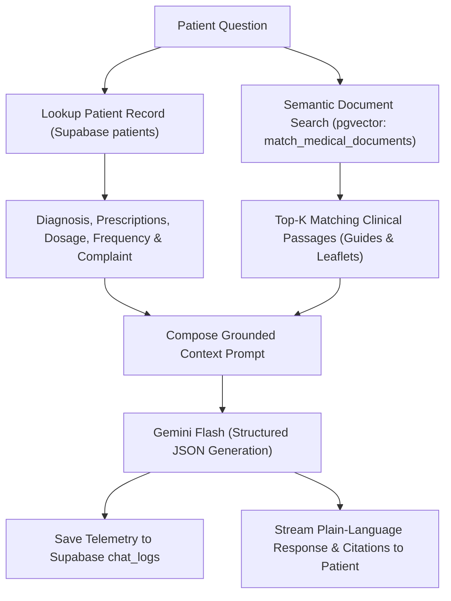

# PulseAI — RAG Clinical Intake & Post-Consultation Platform

**PulseAI** is an end-to-end clinical workflow and Retrieval-Augmented Generation (RAG) patient portal built with **React (Vite)**, **Flask**, **Supabase (`pgvector`)**, **PaddleOCR**, and **Google Gemini Flash**.

---

## 1. Key Features

- **Automated Patient Intake (`PaddleOCR` + `Gemini Flash`)**: Extracts patient registration fields (`full_name`, `dob`, `contact`, `policy_number`, `complaint`) from uploaded PDFs and handwritten forms with real-time empty-field and phone-number validation.
- **Physician Consultation & Knowledge Indexing**: Doctors record diagnoses, specify what symptom each prescribed medication targets, and upload clinical reference documents (guidelines, medication leaflets, lab reports) directly into the vector database.
- **RAG Post-Consultation Patient Portal**: Patients view a plain-language breakdown of their diagnosis and prescriptions, chat with a **RAG Medical Assistant** grounded in their consultation records and uploaded medical documents (with source citations), and export an itemized **Quotation PDF**.
- **Chatbot Analytics Dashboard**: Tracks query volume, unique patients assisted, RAG retrieval hit rate, response latency (`ms`), topic categories, and Q&A audit logs.

---

## 2. System Architecture & RAG Pipeline

```text
[1. Intake]       Document Upload (.pdf/.jpg) ──► pypdf / PaddleOCR ──► Text-Only Gemini Flash ──► Validated JSON
[2. Indexing]     Consultation Notes + Uploaded Medical Docs ──► Chunking (650 chars) ──► 768-d Embeddings ──► pgvector
[3. RAG Chatbot]  Patient Question ──► Query Embedding ──► Top-K Cosine Similarity ──► Grounded Answer + Citations
```

### Chatbot Response Generation Pipeline



### RAG Pipeline: Ingestion to Response Generation

1. **Document Ingestion & Chunking**: Uploaded clinical reference PDFs (leaflets, protocols, guides) are parsed with `pypdf` into raw text and split into overlapping segments of **600 characters with a 100-character overlap** to preserve sentence context across boundaries.
2. **Vector Embedding**: Each chunk is converted into a 768-dimensional dense vector using Google's **`text-embedding-004`** (with `gemini-embedding-001` fallback and SHA-256 memory caching) and stored in the Supabase **`medical_documents`** table (`pgvector`).
3. **Retrieval**: When a patient asks a question, the query is embedded into the same 768-d vector space. The PostgreSQL function `match_medical_documents` runs a cosine similarity search (`<=>`) to retrieve the **top-4 most relevant passages**.
4. **Response Generation**: The retrieved clinical excerpts, the patient's consultation notes (diagnosis, prescriptions, instructions), and recent conversation history are compiled into a grounded prompt. **Gemini 3.5 Flash** (`gemini-3.5-flash-lite` fallback) synthesizes a plain-language answer with citation references—strictly refusing any questions not covered in the provided clinic documents.

### Database Design: Relational vs. Vector Storage
Supabase separates clinical data into two distinct tables:
- **`patients` (Standard Relational Table, No Vectors)**: Stores patient profiles, queue status, visit timestamps, and physician notes using composite primary key `(full_name, created_at)` to support repeat clinic visits.
- **`medical_documents` (Vector Search Table using `pgvector`)**: Stores chunked text from clinical guidelines and leaflets along with a 768-dimensional `vector(768)` column (`gemini-embedding-001`). `pgvector` enables native PostgreSQL cosine distance matching (`<=>`) via the `match_medical_documents` RPC function.

| Stage | Endpoint | Description |
| :--- | :--- | :--- |
| **1. OCR & Extraction** | `POST /extract` | Stores file in Supabase Storage (`documents` bucket), extracts raw text via `pypdf` or `PaddleOCR`, and sends **text only** to Gemini Flash to output structured JSON. |
| **2. Patient Registration** | `POST /register` | Validates required fields and digits-only phone numbers before creating the patient queue entry (`status: "Registered"`). |
| **3. RAG Document Indexing** | `POST /upload-medical-doc` | Splits uploaded medical reference documents into overlapping chunks (`600` chars, `100` overlap), computes 768-dimensional embeddings (`gemini-embedding-001` / `text-embedding-004`), and indexes them in Supabase `pgvector` (`medical_documents`). |
| **4. RAG Medical Chatbot** | `POST /chat` | Embeds the patient's question, retrieves the top-$k$ most relevant chunks via `match_medical_documents` (cosine similarity), and generates a grounded response with source citations. |
| **5. Quotation & Analytics** | `POST /quotation-pdf` & `GET /analytics` | Generates downloadable itemized billing PDFs and aggregates chatbot telemetry (`chat_logs`). |

---

## 3. OCR Evaluation & Token Optimization

### A. `pytesseract` vs. `PaddleOCR` (`PP-OCRv4`)
We evaluated `pytesseract` against `PaddleOCR` (`PP-OCRv4_mobile`) across typed PDFs, neat block handwriting, and freehand cursive camera photos:

| Document Type | `pytesseract` Output | `PaddleOCR` (`PP-OCRv4_mobile`) Output | Engineering Takeaway |
| :--- | :--- | :--- | :--- |
| **Block Handwritten Form** | Misread phone digit (`8839201!`) and dropped field colons. | **100% accurate** (`Elena Rostova`, `2001-01-30`, `88392011`, `PRU-5582-K`, `Sprained right ankle...`). | `PaddleOCR` reliably detects separated handwritten characters and digits. |
| **Freehand Cursive Photo** (Unruled paper) | `""` *(0 characters extracted)* | Partial/noisy: `Regstrotim`, `Sims`, `Bi04/07/1999`, `12345678`, `1(phone):`, `NmA9381G`, `Insiranee`, `Conpany/Reaon` | `PP-OCRv4_mobile` is trained primarily on printed/scene text; connected cursive loops and wavy baselines split words out of order. |

### B. Text-Only vs. Multimodal Image Input to Gemini
`POST /extract` sends **only the extracted OCR text** to Gemini (never the raw image bytes):

| Input Strategy | Avg. Tokens / Form | Est. Cost / 1k Forms | Trade-Off |
| :--- | :--- | :--- | :--- |
| **Text-Only (`PaddleOCR` $\rightarrow$ Gemini)** *(Active)* | **~145 tokens** | **~\$0.03** | Lowest token footprint; missing or illegible OCR fields return `""` and trigger frontend validation for staff review. |
| **Single-Tile Image (`<=768px`) + Text** | **~403 tokens** (`258` image + ~145 text) | **~\$0.07** | ~2.8x token usage, but allows Vision LLM to read cursive script directly from image pixels. |
| **High-Res Image (`1600x1600`) + Text** | **~1,200–2,450 tokens** (4–9 tiles) | **~\$0.20–\$0.38** | ~10–15x token usage due to multi-tile image slicing. |

### C. Further Approaches for Cursive Clinical Forms
1. **Tiered OCR-First + Conditional Vision Fallback**: Run text-only extraction (~145 tokens) first and only attach the `<=768px` image (+258 tokens) when required fields fail validation.
2. **Structured Pre-Printed Forms**: Use printed field labels, horizontal baselines, and character comb boxes for dates, phone numbers, and policy IDs.
3. **Dedicated Handwriting Models (`TrOCR` / `Donut`)**: Pair `PaddleOCR` bounding-box detection with **Microsoft `TrOCR`** (`trocr-base-handwritten`) for local cursive recognition.
4. **OS-Native Apple `Vision` (`VNRecognizeTextRequest`)**: Leverage macOS Neural Engine Live Text OCR for zero-cost local cursive recognition.
5. **OpenCV Preprocessing**: Apply CLAHE contrast normalization and group text boxes by vertical midpoint ($\pm 15\text{ px}$) to preserve reading order on unruled paper.

---

## 4. Quick Start

### Prerequisites
- Node.js 18+ and Python 3.10+
- `.env` configured with `GEMINI_API_KEY`, `VITE_SUPABASE_URL`, and `VITE_SUPABASE_ANON_KEY`
- Run `supabase_schema.sql` in the **Supabase SQL Editor** to initialize `pgvector` tables and storage policies.

### Run Backend (`http://127.0.0.1:5000`)
```bash
source .venv/bin/activate
python app.py
```

### Run Frontend (`http://localhost:5173`)
```bash
npm install
npm run dev
```
