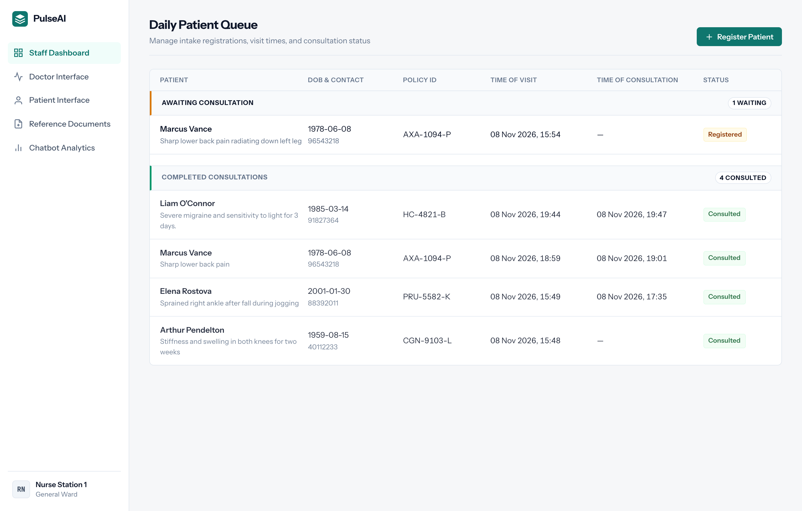
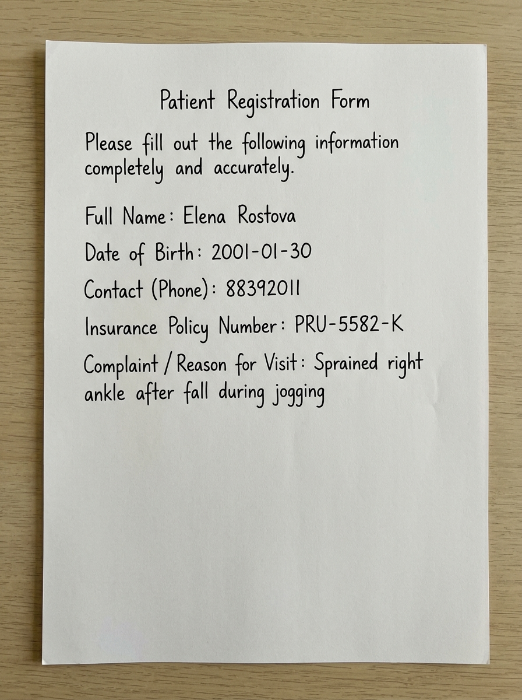
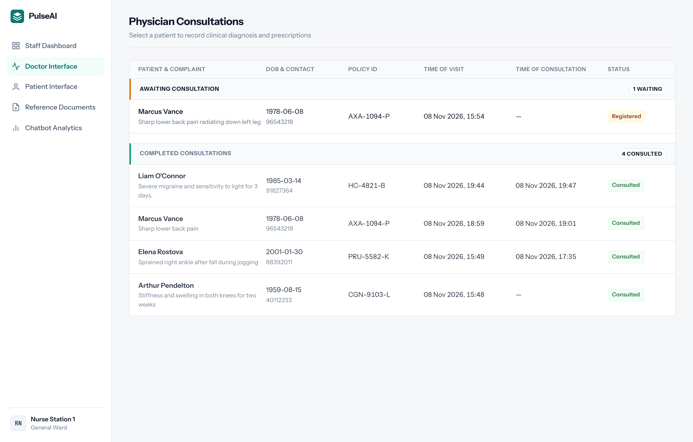
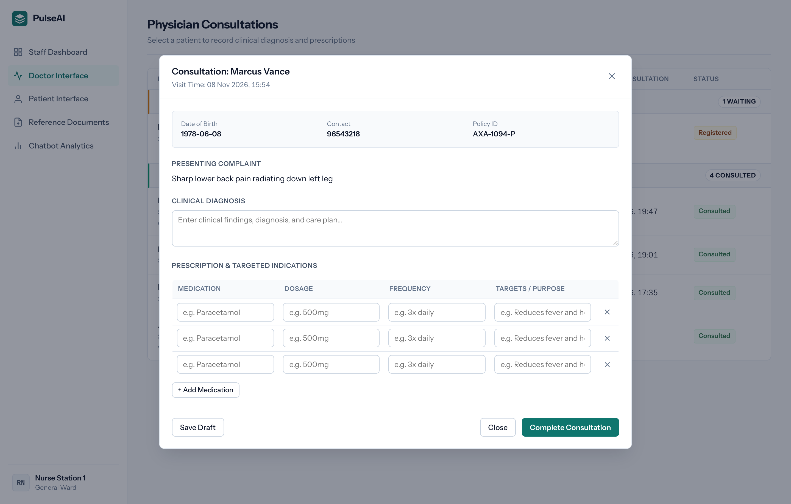
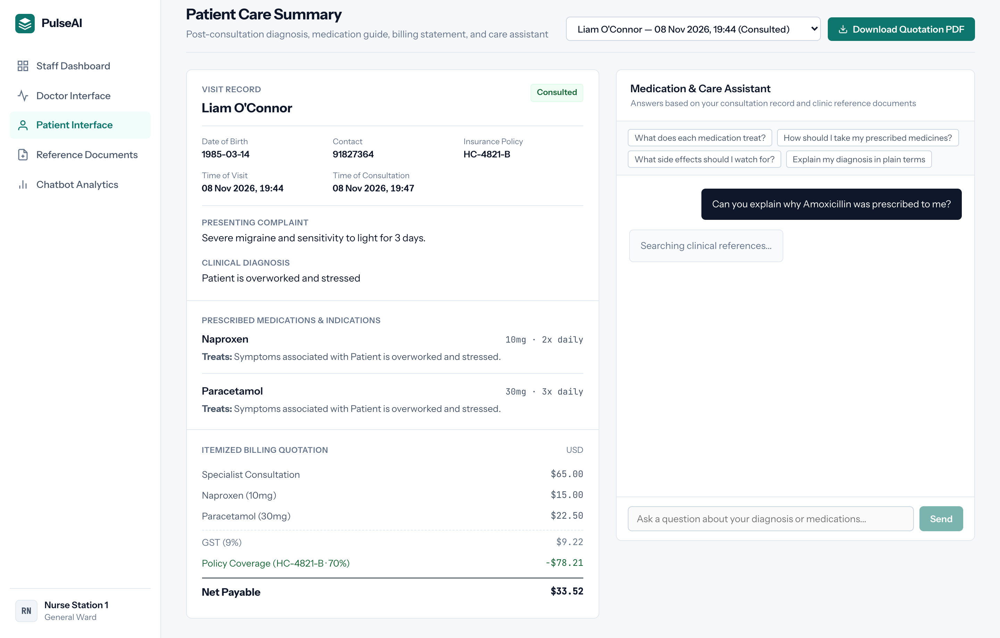
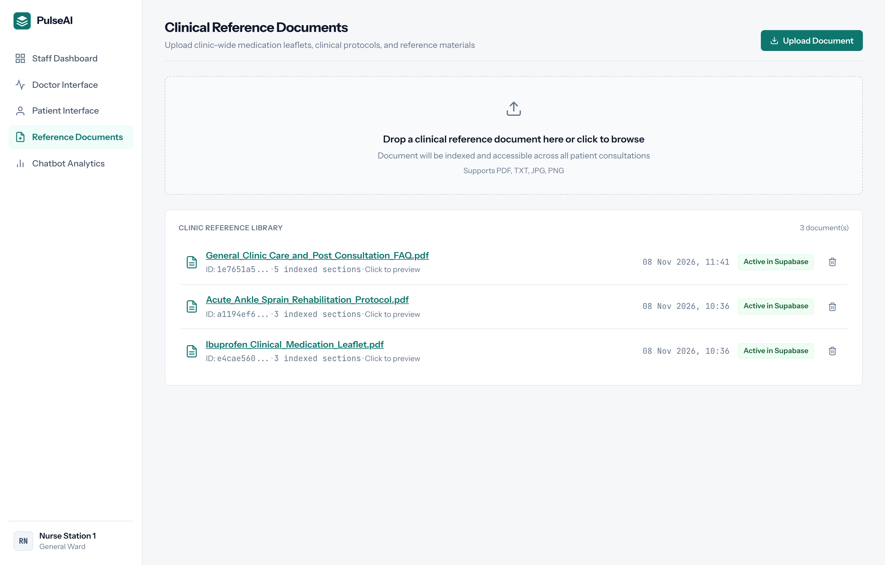
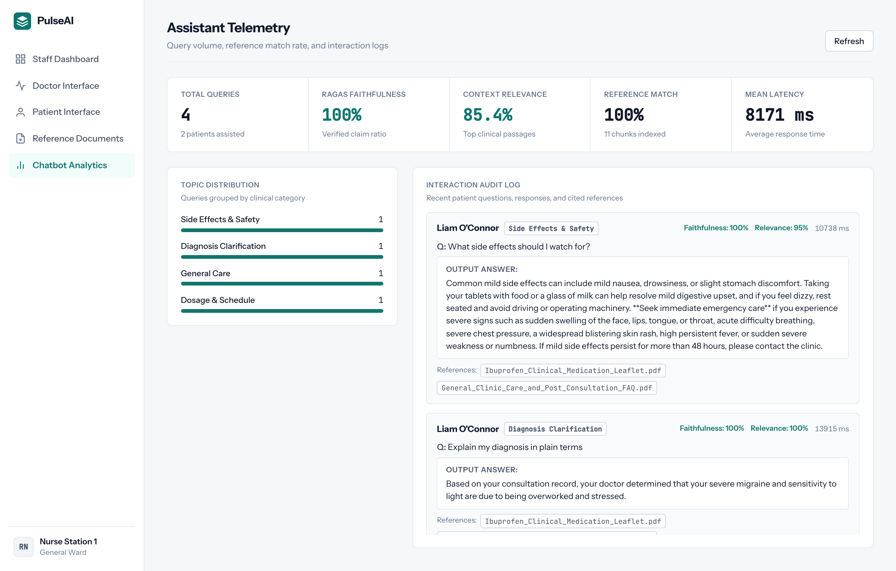
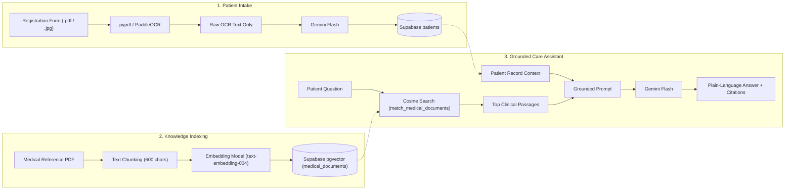

# PulseAI — RAG Clinical Intake & Post-Consultation Platform

**PulseAI** is an end-to-end clinical workflow and Retrieval-Augmented Generation (RAG) patient portal built with **React (Vite)**, **Flask**, **Supabase (`pgvector`)**, **PaddleOCR**, and **Google Gemini Flash**.

---

## 1. Key Features

- **Automated Patient Intake (`PaddleOCR` + `Gemini Flash`)**: Extracts patient registration fields (`full_name`, `dob`, `contact`, `policy_number`, `complaint`) from uploaded PDFs and handwritten forms with real-time empty-field and phone-number validation.
- **Physician Consultation & Knowledge Indexing**: Doctors record diagnoses, specify what symptom each prescribed medication targets, and upload clinical reference documents (guidelines, medication leaflets, lab reports) directly into the vector database.
- **RAG Post-Consultation Patient Portal**: Patients view a plain-language breakdown of their diagnosis and prescriptions, chat with a **RAG Medical Assistant** grounded in their consultation records and uploaded medical documents (with source citations), and export an itemized **Quotation PDF**.
- **Assistant Telemetry & RAGAS Quality Monitoring**: Tracks real-time faithfulness and context relevance metrics alongside response latencies and full conversation audit trails.

---

## 2. Product Walkthrough & Screenshots

### 1. Staff Intake Dashboard
Clinic staff upload printed or handwritten registration forms to automatically extract patient profiles using PaddleOCR and Gemini Flash. Intake records are organized into a two-tier queue separating patients awaiting consultation from those whose visits are complete.

<p align="center">
  
</p>

#### Supported Intake Form Formats
PulseAI accepts both standard typed digital PDF intake documents and clean block-handwritten registration forms photographed or scanned by staff.

<p align="center">
  
  &nbsp;
  
</p>
<p align="center">
  <sub><strong>Left:</strong> Standard digital PDF registration document (parsed via <code>pypdf</code>). &nbsp;|&nbsp; <strong>Right:</strong> Clean block-handwritten intake form (parsed via <code>PaddleOCR</code>).</sub>
</p>

### 2. Physician Consultation Interface & Clinical Records
Physicians manage the active patient queue, review incoming presenting complaints, enter definitive diagnoses, and prescribe medications with targeted symptom mappings and explicit patient instructions.

<p align="center">
  
</p>

#### Physician Consultation Modal
Clicking any patient card opens an editable consultation workspace. Doctors can refine the clinical diagnosis, link specific medications to the symptoms they treat, and save consultation notes that immediately become available to the patient.

<p align="center">
  
</p>

### 3. Grounded Patient Portal & RAG Medical Assistant
Patients can review their diagnosis, read clear explanations of their prescribed medications, and download an itemized billing quotation. They can also ask questions using a grounded medical assistant that cites verified clinic reference documents and their personal consultation notes.

<p align="center">
  
</p>

### 4. Reference Document Knowledge Base
Clinic staff and administrators upload clinical guidelines, medication leaflets, and care protocols directly to the vector library. Each document is chunked into overlapping 600-character passages and vectorized into Supabase `pgvector` using `text-embedding-004`.

<p align="center">
  
</p>

### 5. Assistant Telemetry & RAGAS Analytics
Clinic administrators track assistant reliability through single-pass RAGAS metrics, including Faithfulness and Context Relevance. The dashboard visualizes query topic distributions, response latency trends, and a complete interaction audit log with exact document citations.

<p align="center">
  
</p>

---

## 3. System Architecture & RAG Pipeline



| Stage | Endpoint | Description |
| :--- | :--- | :--- |
| **1. OCR & Extraction** | `POST /extract` | Stores file in Supabase Storage (`documents` bucket), extracts raw text via `pypdf` or `PaddleOCR`, and sends **text only** to Gemini Flash to output structured JSON. |
| **2. Patient Registration** | `POST /register` | Validates required fields and digits-only phone numbers before creating the patient queue entry (`status: "Registered"`). |
| **3. RAG Document Indexing** | `POST /upload-medical-doc` | Splits uploaded medical reference documents (including clinic care and post-consultation FAQ leaflets) into overlapping chunks (`600` chars, `100` overlap), computes 768-dimensional embeddings (`gemini-embedding-001` / `text-embedding-004`), and indexes them in Supabase `pgvector` (`medical_documents`). |
| **4. RAG Medical Chatbot** | `POST /chat` | Embeds the patient's question, retrieves top-k relevant chunks via `match_medical_documents` (cosine similarity), evaluates single-pass RAGAS faithfulness/relevance, logs telemetry to `chat_logs`, and returns a grounded response with source citations. |
| **5. Assistant Telemetry** | `GET /analytics` | Aggregates mean RAGAS faithfulness, context relevance, average response latency, topic distributions, and historical interaction audit logs from `chat_logs`. |
| **6. Patient Quotation** | `POST /quotation-pdf` | Generates a downloadable itemized billing PDF with breakdown of consultation fees, prescribed medications, and insurance coverage. |

### Database Design: Relational vs. Vector Storage
Supabase separates clinical data into three primary tables:
- **`patients` (Relational Table)**: Stores patient profiles, queue status, visit timestamps, and physician notes using composite primary key `(full_name, created_at)` to support repeat clinic visits.
- **`medical_documents` (Vector Search Table using `pgvector`)**: Stores chunked text from clinical guidelines and leaflets along with a 768-dimensional `vector(768)` column (`text-embedding-004`). `pgvector` enables native PostgreSQL cosine distance matching (`<=>`) via the `match_medical_documents` RPC function.
- **`chat_logs` (Telemetry & Evaluation Table)**: Records every patient-assistant interaction with patient ID, question, answer, topic category, cited references, latency, and single-pass RAGAS quality scores.

### RAG Pipeline: Ingestion to Response Generation
1. **Document Ingestion & Chunking**: Uploaded clinical reference PDFs (leaflets, protocols, guides) are parsed with `pypdf` into raw text and split into overlapping segments of **600 characters with a 100-character overlap** to preserve sentence context across boundaries.
2. **Vector Embedding**: Each chunk is converted into a 768-dimensional dense vector using Google's **`text-embedding-004`** (with `gemini-embedding-001` fallback and SHA-256 memory caching) and stored in the Supabase **`medical_documents`** table (`pgvector`).
3. **Retrieval**: When a patient asks a question, the query is embedded into the same 768-d vector space. The PostgreSQL function `match_medical_documents` runs a cosine similarity search (`<=>`) to retrieve the **top-4 most relevant passages**.
4. **Response Generation**: The retrieved clinical excerpts, the patient's consultation notes (diagnosis, prescriptions, instructions), and recent conversation history are compiled into a grounded prompt. **Gemini 3.5 Flash** (`gemini-3.5-flash-lite` fallback) synthesizes a plain-language answer with citation references—strictly refusing any questions not covered in the provided clinic documents.

### Chatbot Response Generation
1. **Patient Record Retrieval (`Supabase`)**: Fetches the patient's verified clinical record from the `patients` table—including physician diagnosis, prescribed medications, exact dosages, intake frequency, and administration instructions.
2. **Query Vectorization (`text-embedding-004`)**: Converts the patient's natural-language inquiry into a 768-dimensional dense vector embedding.
3. **Semantic Similarity Search (`Supabase pgvector`)**: Executes the PostgreSQL stored procedure `match_medical_documents`, performing cosine distance search (`<=>`) across all uploaded clinical PDFs to retrieve the top-4 most relevant passage chunks.
4. **Context Assembly (`Python / Flask`)**: Constructs a grounded system prompt combining the patient's consultation notes, retrieved reference excerpts, and recent conversation history—with strict instructions to refuse any out-of-scope or undocumented queries.
5. **Grounded Generation (`Gemini 3.5 Flash`)**: Synthesizes a plain-language, patient-friendly response with clickable document source citations, structured as a clean JSON payload.

### RAGAS Evaluation Metrics Calculation
To ensure clinical safety and groundedness without tripling LLM token cost or latency, PulseAI evaluates each response using a single-pass RAGAS assessment model alongside cosine retrieval:

1. **Faithfulness Score ($F$)**:
   $$\text{Faithfulness} = \frac{|\text{Claims in Answer Grounded in Context}|}{|\text{Total Claims in Answer}|}$$
   - **Clinical Purpose**: Guarantees zero hallucination by verifying that dosage instructions, contraindications, and medical advice strictly match the uploaded clinical documents or consultation notes.

2. **Context Relevance Score ($R$)**:
   $$\text{Context Relevance} = \frac{|\text{Retrieved Sentences Addressing Question}|}{|\text{Total Retrieved Sentences}|}$$
   - **Clinical Purpose**: Validates retrieval precision, ensuring noise or irrelevant reference chunks do not pollute the generation prompt.

Both metrics ($0.0 \text{--} 1.0$) and roundtrip latencies are logged to `public.chat_logs` and monitored in the **Chatbot Analytics** dashboard with full interaction audit trails.

---

## 4. OCR Evaluation & Token Optimization

### A. `pytesseract` vs. `PaddleOCR` (`PP-OCRv4`)
We evaluated `pytesseract` against `PaddleOCR` (`PP-OCRv4_mobile`) across typed PDFs, neat block handwriting, and freehand cursive camera photos:

| Document Type | `pytesseract` Output | `PaddleOCR` (`PP-OCRv4_mobile`) Output | Engineering Takeaway |
| :--- | :--- | :--- | :--- |
| **Block Handwritten Form** | Misread phone digit (`8839201!`) and dropped field colons. | **100% accurate** (`Elena Rostova`, `2001-01-30`, `88392011`, `PRU-5582-K`, `Sprained right ankle...`). | `PaddleOCR` reliably detects separated handwritten characters and digits. |
| **Freehand Cursive Photo** (Unruled paper) | `""` *(0 characters extracted)* | Partial/noisy: `Regstrotim`, `Sims`, `Bi04/07/1999`, `12345678`, `1(phone):`, `NmA9381G`, `Insiranee`, `Conpany/Reaon` | `PP-OCRv4_mobile` is trained primarily on printed/scene text; connected cursive loops and wavy baselines split words out of order. |

### B. Text-Only vs. Multimodal Image Input to Gemini
`POST /extract` sends **only the extracted OCR text** to Gemini (never the raw image bytes):

| Input Strategy | Avg. Tokens / Form | Est. Cost / 1k Forms | Trade-Off |
| :--- | :--- | :--- | :--- |
| **Text-Only (`PaddleOCR` $\rightarrow$ Gemini)** *(Active)* | **~145 tokens** | **~\$0.03** | Lowest token footprint; missing or illegible OCR fields return `""` and trigger frontend validation for staff review. |
| **Single-Tile Image (`<=768px`) + Text** | **~403 tokens** (`258` image + ~145 text) | **~\$0.07** | ~2.8x token usage, but allows Vision LLM to read cursive script directly from image pixels. |
| **High-Res Image (`1600x1600`) + Text** | **~1,200–2,450 tokens** (4–9 tiles) | **~\$0.20–\$0.38** | ~10–15x token usage due to multi-tile image slicing. |

### C. Further Approaches for Cursive Clinical Forms
1. **Tiered OCR-First + Conditional Vision Fallback**: Run text-only extraction (~145 tokens) first and only attach the `<=768px` image (+258 tokens) when required fields fail validation.
2. **Structured Pre-Printed Forms**: Use printed field labels, horizontal baselines, and character comb boxes for dates, phone numbers, and policy IDs.
3. **Dedicated Handwriting Models (`TrOCR` / `Donut`)**: Pair `PaddleOCR` bounding-box detection with **Microsoft `TrOCR`** (`trocr-base-handwritten`) for local cursive recognition.
4. **OS-Native Apple `Vision` (`VNRecognizeTextRequest`)**: Leverage macOS Neural Engine Live Text OCR for zero-cost local cursive recognition.
5. **OpenCV Preprocessing**: Apply CLAHE contrast normalization and group text boxes by vertical midpoint ($\pm 15\text{ px}$) to preserve reading order on unruled paper.

---

## 5. Future Work & Engineering Roadmap

### A. Advanced Handwriting, Multipage Intake & Next-Gen OCR
- **Multipage PDF & Batch Form Ingestion**: Expand the intake engine to process multipage clinical questionnaires, insurance claim attachments, and multipage hospital discharge summaries with cross-page entity resolution.
- **Next-Gen Handwriting & Specialized Vision Models**: Benchmark specialized Document AI and handwriting-oriented architectures including **Microsoft `TrOCR`** (`trocr-base-handwritten`), **Donut** (OCR-free document understanding), and **GOT-OCR2.0** against challenging medical scripts, rushed doctor notes, and unruled cursive writing.
- **Tiered Multi-Modal Fallback**: Implement dynamic token budgeting that runs low-cost text OCR first (~145 tokens) and escalates only low-confidence or missing fields to multimodal vision tiles (`<=768px`) to minimize inference costs while maximizing field accuracy.

### B. Role-Based Identity & Access Management (IAM)
- **Separated User Portals & Access Tiers**: Decouple the consolidated single-page navigation into distinct authenticated routes tailored for each clinical role:
  - **Front Desk / Reception**: Restricted to patient intake, identity verification, and queue registration.
  - **Attending Physicians**: Dedicated clinical workspace with diagnostic inputs, prescription builder, and medical record authorization.
  - **Patients**: Secure authentication (via OTP or magic link) restricted strictly to their personal consultation summary, billing quotation, and grounded chat history.
  - **Clinical Administrators**: System telemetry, RAGAS observability dashboard, document vectorization library, and audit trails.
- **Supabase Row-Level Security (RLS)**: Enforce strict database-level security policies (`auth.uid() = patient_id`) ensuring patients cannot access other records or query unassigned clinical notes.

### C. Enhanced Clinical RAG & Safety Guardrails
- **Hybrid Search (Dense Vector + BM25 Lexical Keyword)**: Combine `pgvector` cosine similarity with PostgreSQL full-text search (`tsvector` / Reciprocal Rank Fusion) to ensure exact-match precision for medical codes (ICD-10), drug dosages, and brand names.
- **Semantic Caching & Automated Clinical Triaging**: Cache verified answers to common post-consultation inquiries to reduce token consumption and latency, and introduce red-flag heuristic classifiers to immediately route urgent symptoms (e.g., chest pain, severe allergic reaction) to emergency emergency services.
- **Multi-Turn RAGAS Automated Auditing**: Run automated synthetic evaluations on conversation datasets using the full RAGAS framework (Answer Relevance, Context Recall, Aspect Critique) to proactively monitor against guideline drift.

---

## 6. Quick Start

### Prerequisites
- Node.js 18+ and Python 3.10+
- `.env` configured with `GEMINI_API_KEY`, `SUPABASE_URL`, and `SUPABASE_KEY` (see `.env.example`)
- Run `supabase_schema.sql` in the **Supabase SQL Editor** to initialize `pgvector` tables and storage policies.

### Run Backend (`http://127.0.0.1:5001`)
```bash
source .venv/bin/activate
python app.py
```

### Run Frontend (`http://localhost:5173`)
```bash
npm install
npm run dev
```
